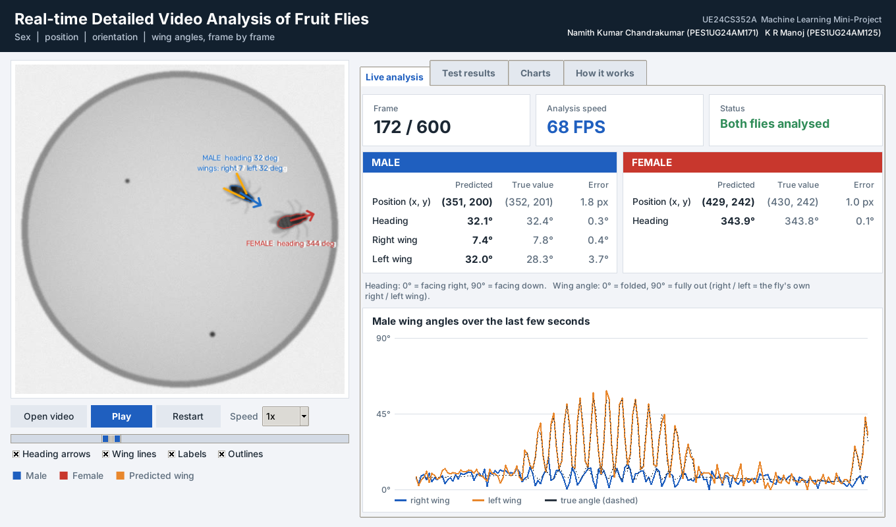

# Real-time Detailed Video Analysis of Fruit Flies

**UE24CS352A – Machine Learning – Mini-Project**
Team: **Sriranga Bhardwaj** (PES1UG24AM286) · **Sumuk D Hegde** (PES1UG24AM296) · **Shraddha** (PES1UG25AM812)

Given a grayscale video of one male and one female fruit fly, the system annotates **every
frame** with

* each fly's **sex**, **position** and **heading** (which way it faces, 0–360°)
* the male's **right and left wing angle** (0° = folded, 90° = fully out)

and it does so **faster than the 30 FPS video plays**, on an ordinary CPU, using classical
machine learning (decision tree, logistic / linear regression, PCA, HOG features).
It re-implements the approach of S. Herbst, *Real-time Detailed Video Analysis of Fruit Flies*
(Stanford CS229, 2018).

---

## Quick start

```bash
pip install -r requirements.txt     # Python 3.9+ ; use a virtual environment if you like
python gui.py                       # graphical demo (uses the bundled model and test video)
```



`gui.py` works straight away: the trained model (`models/pipeline.joblib`) and the test video
(`data/video.avi`) are included in the repository.
If scikit-learn prints a version warning or cannot load the model, simply rebuild it with
`python generate_dataset.py` and `python train_evaluate.py` (about a minute).

### Windows virtual environment (optional)
```
python -m venv .venv
.venv\Scripts\activate
pip install -r requirements.txt
```

## Run the whole project from scratch (about 1.5 minutes)

| Step | Command | What it does |
|---|---|---|
| 1 | `python generate_dataset.py` | Simulates 900 labelled frames (`data/frames`) and the 600-frame test video |
| 2 | `python train_evaluate.py` | Trains the 4 models, tests them on unseen frames, prints a results table, saves `models/pipeline.joblib` and `results/metrics.json` |
| 3 | `python demo.py` | Analyses the test video, prints a plain-English report, saves `results/demo_output.avi` |
| 3b | `python demo.py --show` | Same, with a live window (press `q` to quit) |
| 4 | `python gui.py` | Graphical interface (see below) |
| 5 | `python make_figures.py` then `python make_report.py` | Rebuild the figures and the 2-page PDF write-up |

Use your own video: `python demo.py --video your.avi --no-gt` (grayscale, two flies of similar
size to ours; `--no-gt` skips the accuracy check because there are no true labels).

## The GUI (`python gui.py`)

* **Left:** the video with outlines (blue = male, red = female), heading arrows and orange
  predicted-wing lines. Play / pause (space bar), restart, speed (0.5x, 1x, 2x, Max), a scrub bar,
  *Open video* for any other file, and switches for arrows, wings, labels and outlines.
* **Live analysis tab:** frame number, analysis speed, status, and a table for each fly with the
  *predicted* value, the *true* value and the *error*, plus a live plot of the male's wing angles.
* **Test results tab:** the headline accuracy numbers, the per-stage test/training error table and
  the time spent per frame (read from `results/*.json`).
* **Charts tab:** all result figures. **How it works tab:** a short explanation.

On Linux, tkinter may need `sudo apt install python3-tk`. It is included with Python on Windows and macOS.

## Understanding the output

`python demo.py` prints (numbers are an example):

| Line in the report | Meaning |
|---|---|
| **Analysis speed … frames per second** | How many frames the pipeline analyses per second. Must be above the video's 30 FPS to count as real-time. |
| **… ms per frame** | The same speed as time: 1000 ÷ FPS. |
| **Compared to video … x faster** | Speed divided by the video's frame rate. |
| **Where the time goes** | Milliseconds per frame spent in reading the video and in each of the 4 stages. |
| **Analysed successfully** | Frames where both flies were found and analysed. |
| **Skipped (flies touching)** | The flies formed one merged blob, so the frame was skipped (the last result is shown). |
| **Skipped (could not resolve flies)** | Fewer than two separate flies were found. |
| **Flies checked** | Number of flies compared with the truth (frames × 2). |
| **Sex identified correctly** | % of flies labelled with the right sex. |
| **Position error (average)** | Average distance, in pixels, between the predicted and true fly centre. |
| **Heading error (average / median)** | Difference in degrees between predicted and true facing direction. |
| **Headings within 15 degrees** | % of flies whose heading is within 15° of the truth. |
| **Wing-angle error (average)** | Average size of the wing-angle mistake, in degrees. |
| **Wing-angle error (spread, std dev)** | How much the wing-angle mistakes vary around their average. |
| **Wing-angle bias** | Average signed mistake: positive = wings over-estimated, near 0 = no systematic bias. |

`python train_evaluate.py` prints, for each stage, the **training error** (on frames used to
learn) and the **test error** (on frames never seen). Stages 1–3: % of wrong decisions.
Stage 4: spread (std dev) of the wing-angle error in degrees. Lower is better; test error is the
honest one. All numbers are also saved in `results/metrics.json` and `results/demo_summary.json`
with self-explanatory names (e.g. `sex_correct_percent`, `heading_error_degrees_average`).

## How it works

| Stage | Question | Model |
|---|---|---|
| 1 Fly counting | debris, one fly, or two touching flies? | decision tree on the blob area |
| 2 Sex identification | which of the two flies is the male? | standardise + logistic regression on area and aspect ratio |
| 3 Orientation | which way is each fly facing? | image moments give the body axis; HOG → PCA(15) → logistic regression decides head vs tail; heading = axis (+180° if flipped) |
| 4 Wing angles | how far is each male wing out? | male rotated upright, legs and other fly masked out; HOG → PCA(40) → linear regression (left wing mirrored so one model serves both) |

*HOG* = histogram of oriented gradients (describes a shape by its edge directions); *PCA* =
principal component analysis (compresses the descriptor to its most informative directions).

## Data

The reference project's lab video is not public, so the data are **simulated**
(`src/synth.py`): a male and a female fly in a circular well with wings, legs, blur, noise and
debris. Every label (sex, position, heading, wing angles) is therefore exact.

* 900 independent labelled 512×512 frames → 600 train / 300 test (split by frame)
* a separate 600-frame (20 s) courtship video with a different random seed, never used for training
* `data/sample_frames/` holds a few examples; `data/frames/` is created by `generate_dataset.py`

## Results (accuracy numbers are deterministic; FPS depends on your computer)

| Stage | Training error | Test error |
|---|---|---|
| 1 Fly counting | 0.36 % | 0.92 % |
| 2 Sex identification | 0.00 % | 0.69 % |
| 3 Orientation (male / female) | 0.00 % / 0.00 % | 0.00 % / 0.00 % |
| 4 Wing angles (error spread) | 4.26° | 5.15° |

Held-out video, whole pipeline: 99.33 % correct sex, heading error 0.64° (average),
wing-angle error 2.02° (average), no frame skipped. Speed: about 60–85 frames per second in our
tests (30 needed for real-time).

## Project layout

```
gui.py                graphical interface
demo.py               run the pipeline on a video, print the report, save the annotated video
generate_dataset.py   simulate the dataset and the test video
train_evaluate.py     features, training, evaluation, PCA study, figures
make_figures.py       figures for the write-up / slides
make_report.py        builds Fruit_Fly_Video_Analysis_Writeup.pdf from results/*.json
src/synth.py          fly simulator (renderer + courtship trajectories)
src/features.py       thresholding, contours, moments, rotation, HOG
src/pipeline.py       model definitions + FlyPipeline.process(frame)
src/evaluation.py     comparison with ground truth + report text
src/visualize.py      drawing the overlay on a frame
models/               trained pipeline
data/                 annotations, test video, sample frames
results/              metrics, figures, annotated video
```

## Limitations

* Results are on simulated data, which is cleaner than real lab footage; performance on real
  video is not measured here.
* When the flies touch they form one blob; that frame is skipped and the last result is shown.
* Stage 1 uses only the blob area, so debris of fly-like size can fool it.

## Team contributions

See [CONTRIBUTIONS.md](CONTRIBUTIONS.md).
